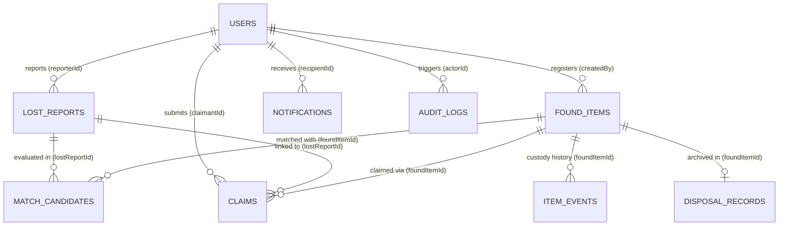

# VaultTrace — Intelligent Lost & Found Object Tracking and Recovery System

**VaultTrace** is a database-centric **MERN Stack (MongoDB, Express.js, React + Vite, Node.js)** web application engineered for campus lost-and-found inventory management, deterministic multi-signal matching, restricted-proof claim verification, QR-tagged custody tracking, and configurable small-item stationery retention/disposal.

---

## 1. Key Highlights & Unique Value-Add Features

1. **10-Collection Normalized + Hybrid MongoDB Architecture**:
   - `users`, `lostReports`, `foundItems`, `matchCandidates`, `claims`, `notifications`, `itemEvents`, `disposalRecords`, `auditLogs`, and `campusLocations`.
   - Uses `ObjectId` references for independently queried entities and bounded embedded snapshots (`fromStatus`/`toStatus`, `itemCodeSnapshot`, `scoreBreakdown`) for immutable history.
2. **Deterministic Weighted Matching Engine (0–100 Score)**:
   - Evaluates **Category (25%)**, **Keywords/Text Overlap (20%)**, **Colour/Material/Size (15%)**, **Campus Location & Building Zone Proximity (15%)**, **Date Proximity (15%)**, and **Brand (10%)**.
   - Categorizes matches into **High Potential Match (75–100%)** and **Possible Match (50–74%)** and triggers idempotent in-app notifications.
3. **Restricted Ownership Verification & Single-Approved-Claim Integrity**:
   - Sensitive ownership clues (`serialOrIdFragment`, `hiddenMarkOrScratch`, `lockedScreenOrContents`) and exact physical storage bins (`storageLocation`) are stripped from student/public API responses.
   - Service-level checks enforce that **only one active approved claim** can exist per physical item.
4. **Configurable Small-Item Stationery Retention, Batch Intake & Claim Freeze (No Hard-Delete / No TTL Deletion)**:
   - Supports **Quick Stationery Batch Intake** (grouping low-value pens/pencils/rulers by box and lot quantity).
   - Scheduled eligibility scans move expired `Stored` items into `Disposal Review` while respecting **Claim Freeze** (any active claim or high-confidence match pauses disposal eligibility).
   - Includes a **Time-Travel Retention Simulator** (`+40 Days Ageing`) so evaluators can watch the retention policy and claim-freeze rules execute live.
5. **Interactive Live DBMS Query Lab & Document Editor (`/dbms-lab`)**:
   - Run preset `$lookup` joins, `$group` aggregations, `$text` full-text search, and `explain('executionStats')` index performance inspections directly in the browser.
   - Edit any MongoDB document live in JSON (validated via Mongoose schemas and logged to `auditLogs`) or test `E11000` unique index and enum constraints with one click.
6. **Interactive Campus Zone Heatmap & QR Custody Tags**:
   - Live spatial heatmap across campus zones plus printable **QR Storage Tags** and **QR Handover Passes**.
7. **Zero-Config Local & Vercel Deployment Ready**:
   - Connects to `MONGODB_URI` (MongoDB Atlas or local MongoDB Community Server `mongodb://127.0.0.1:27017/vaulttrace_db`) and automatically falls back to an embedded MongoDB engine (`mongodb-memory-server`) with auto-seeding if local `mongod` is not running.

---

## 2. Logical ER Relationship Diagram



---

## 3. MongoDB Index Inventory & Rationale

| Collection | Index Definition | Type | DBMS Purpose |
| :--- | :--- | :--- | :--- |
| `users` | `{ email: 1 }` | Unique | Fast login lookup & duplicate account prevention |
| `lostReports` | `{ reporterId: 1, status: 1, createdAt: -1 }` | Compound | User's active and historical lost reports sorted newest-first |
| `lostReports` | `{ category: 1, status: 1, 'lastSeen.location': 1 }` | Compound | Filter active lost reports by category and campus location |
| `lostReports` | `{ itemName: 'text', description: 'text', 'attributes.brand': 'text' }` | Weighted Text | Full-text keyword matching |
| `foundItems` | `{ itemCode: 1 }` | Unique | Fast lookup by physical QR tag / Item Code |
| `foundItems` | `{ status: 1, category: 1, foundAt: -1 }` | Compound | Admin inventory filtering & student vault explorer |
| `foundItems` | `{ storageLocation: 1, status: 1 }` | Compound | Physical vault bin auditing |
| `foundItems` | `{ eligibleForDisposalAt: 1, status: 1 }` | Compound | Daily scheduled retention eligibility scan |
| `matchCandidates` | `{ lostReportId: 1, foundItemId: 1 }` | Unique Compound | Prevents duplicate candidate pairs across matching runs |
| `claims` | `{ foundItemId: 1, status: 1 }` | Compound | Enforces single active approved claim & claim-freeze checks |
| `notifications` | `{ recipientId: 1, readAt: 1, createdAt: -1 }` | Compound | Unread notification badge & inbox sorting |
| `itemEvents` | `{ foundItemId: 1, timestamp: -1 }` | Compound | Chronological append-only item custody timeline |
| `auditLogs` | `{ entityType: 1, entityId: 1, timestamp: -1 }` | Compound | Entity-specific security & mutation audit trail |

---

## 4. Seeded Demo Personas (Password: `VaultPass@123`)

You can switch between all personas with **one click** using the top **Evaluator Demo Bar** in the UI:

| Role | Name | Email | Identifier |
| :--- | :--- | :--- | :--- |
| **Admin** | Dr. Raghavendra Rao | `admin@vaulttrace.edu` | `ADM-RV-001` |
| **Staff** | Suresh Gowda | `staff@vaulttrace.edu` | `STF-RV-104` |
| **Student** | Aarav Sharma | `student@vaulttrace.edu` | `STU-ISE-042` |
| **Student** | Diya Nair | `diya.nair@vaulttrace.edu` | `STU-CSE-089` |
| **Student** | Karthik Hegde | `karthik.hegde@vaulttrace.edu` | `STU-ECE-019` |

---

## 5. Setup & Running Instructions

### Local Development
```bash
# 1. Install dependencies (root, server, and client)
npm install
npm --prefix server install
npm --prefix client install

# 2. Run automated DBMS & API verification suite (12 checks)
npm test

# 3. Start both Backend (port 5000) and Frontend (port 5173)
npm run dev
```

### Deploying to Vercel
1. Push this repository to GitHub and import it into **Vercel**.
2. Add the environment variable `MONGODB_URI` (your MongoDB Atlas connection string) and `JWT_SECRET` in the Vercel project settings.
3. `vercel.json` and `api/index.js` are pre-configured to serve the React Vite SPA and route all `/api/*` endpoints through the Express + Mongoose backend.
